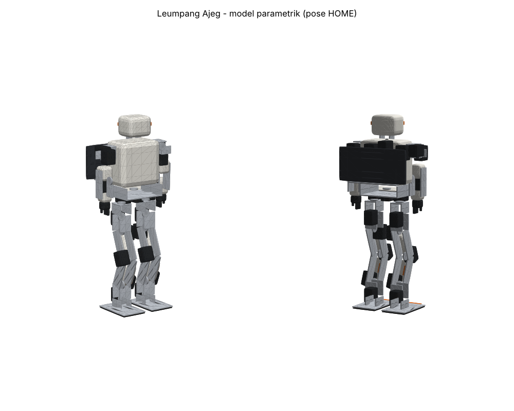

# Leumpang Ajeg

**Leumpang ajeg** (bahasa Sunda: *berjalan dengan mantap*) — kontroler keseimbangan dan langkah UVC
untuk robot humanoid KHR, dengan inti portabel untuk ESP32-S3, ESP32-P4, dan STM32H562,
simulator, studio desktop dengan digital twin 3D, serta protokol bersama untuk HP Android ("mata").



> *Leumpang Ajeg — UVC balance & walking controller for a KHR humanoid. Portable C++ core, ESP-IDF firmware,
> host simulator, and the LAP protocol for Android perception and a desktop digital twin.*

## Status

| Bagian | Status |
|---|---|
| leumpang-core (UVC, IK, state machine, keselamatan) | ✅ terbukti identik dengan firmware V4 |
| Protokol LAP v1 (C++ / Python) | ✅ |
| Firmware ESP32-S3 (ESP-IDF) | ✅ kode + CI; ⏳ uji hardware |
| Firmware ESP32-P4 FireBeetle 2 (ESP-IDF, Wi-Fi via C6) | ✅ kode + CI; ⏳ uji hardware |
| Firmware STM32H562 WeAct (bare-metal, USB CDC) | ✅ kode + CI; ⏳ uji hardware |
| SD card: template gerak + blackbox | ✅ |
| Gait kontinu `GAIT_INTENT` (mode 800, eksperimental) | ✅ simulasi |
| Motion player LAM1 (mode 810) | ✅ simulasi |
| Live pose `POSE_TARGET` (mode 820) | ✅ simulasi |
| Simulator host + `lapctl` | ✅ |
| **Leumpang Studio** (Qt 6, Windows/Linux): twin 3D, servo, gerak, kamera pose | ✅ CI + selftest |
| Model 3D parametrik (STL + URDF) | ✅ |
| **Leumpang Mata** (Android): hindari rintangan, ikuti orang, isyarat tangan, wajah/objek, suara | ✅ kode + CI; ⏳ uji di HP |
| Refleks rintangan firmware (`PERCEPTION`) + Leumpang Bus API (`EXT`, WebSocket) | ✅ simulasi |

Lihat [docs/ROADMAP.md](docs/ROADMAP.md), [docs/ARCHITECTURE.md](docs/ARCHITECTURE.md), [docs/PROTOCOL.md](docs/PROTOCOL.md).

## Mulai cepat (tanpa hardware)

```bash
cmake -B build && cmake --build build -j
ctest --test-dir build --output-on-failure        # semua tes

./build/leumpang_sim                              # simulator robot, LAP di 127.0.0.1:5760
python3 tools/lapctl.py --tcp 127.0.0.1 watch --servo
python3 tools/lapctl.py --tcp 127.0.0.1 cmd go
python3 tools/lapctl.py --tcp 127.0.0.1 sim-imu 0 40
```
Di terminal simulator Anda juga bisa mengetik perintah konsol robot (`r g x c t y z ?`).

## Leumpang Studio (desktop)

Unduh paket Windows dari tab **Actions** → run terbaru di `main` → artefak **LeumpangStudio-windows-x64**,
ekstrak, jalankan `leumpang_studio.exe`, pilih **Simulator** → **Hubungkan** untuk mencoba tanpa robot.
Detail fitur dan build: [studio/README.md](studio/README.md).

## Leumpang Mata (Android)

APK dari tab **Actions** → artefak **LeumpangMata-apk**. Panduan pasang, kamera kepala, dan daya: [android/README.md](android/README.md).
API antar-modul / sensor: [docs/BUS.md](docs/BUS.md).

## Clone

```bash
git clone --recursive https://github.com/tomrzetd/leumpang_ajeg.git
# sudah terlanjur clone tanpa --recursive:
git submodule update --init --recursive
```

## Firmware

| Board | Folder | Build | Link ke HP/PC |
|---|---|---|---|
| ESP32-S3 N16R8 | [firmware/esp](firmware/esp/README.md) | `idf.py set-target esp32s3 build` (IDF ≥ 5.3) | Wi-Fi `192.168.4.1:5760`, UART |
| ESP32-P4 FireBeetle 2 | [firmware/esp](firmware/esp/README.md#5a-esp32-p4-firebeetle-2) | `idf.py set-target esp32p4 build` (IDF ≥ 5.5) | Wi-Fi (C6), USB-C |
| STM32H562 WeAct | [firmware/stm32h562](firmware/stm32h562/README.md) | `cmake -B build -DCMAKE_TOOLCHAIN_FILE=cmake/arm-none-eabi.cmake` | USB-C (CDC) |

Board ESP: SoftAP `LEUMPANG-AJEG-xxxx`, dashboard `http://192.168.4.1` / `http://leumpang-ajeg.local`.
Semua board: `python3 tools/lapctl.py --serial /dev/ttyACM0 hello`.

### Template gerak

```bash
python3 tools/lam.py build motions/lambai.json lambai.lam
python3 tools/lapctl.py --tcp 192.168.4.1 motion-upload lambai.lam 0    # disimpan juga ke SD
python3 tools/lapctl.py --tcp 192.168.4.1 motion-play 0                 # dari READY
```

⚠️ Ganti `WIFI_AP_PASS` dan `DASH_PASS` di `firmware/esp/main/app_config.h`, dan persempit
batas `lo/hi` tiap sendi di `core/src/controller.cpp` (`JOINTS`) sebelum uji lantai.
Gait kontinu mati secara default (`param gaitEnable 1` untuk menyalakan); uji dulu di simulator.

## Lisensi

[MIT](LICENSE). Submodule `firmware/third_party/esp_hosted` berlisensi Apache-2.0 (Espressif);
ONNX Runtime (diunduh saat build studio) berlisensi MIT (Microsoft).
